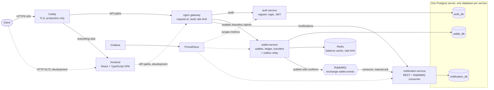
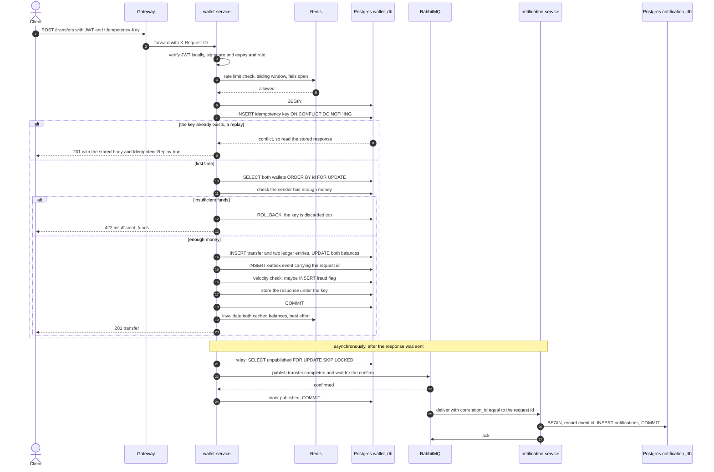
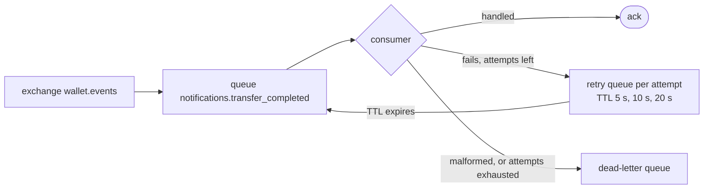
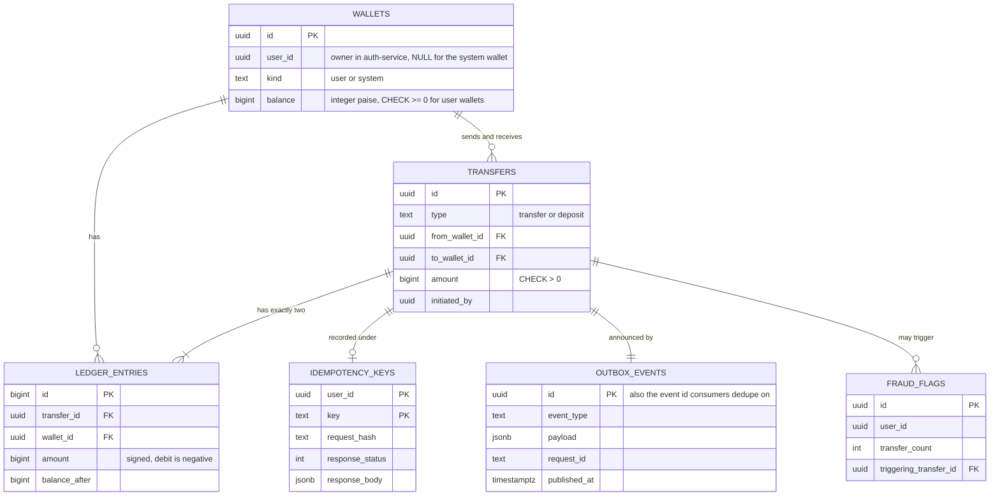

# Distributed Wallet & Payments Platform

A small payments backend built to show how money-moving software is made **correct** before it is made fast:
users hold wallets, move integer paise between each other, and every movement is recorded in a **double-entry
ledger** inside a single database transaction. Three FastAPI microservices, an Nginx gateway, Postgres, Redis,
RabbitMQ, Prometheus and Grafana, all started with one `docker compose` command.

> **Portfolio project.** The goal was a system whose guarantees can be *proved by tests* (parallel transfers,
> duplicate requests, opposite-direction deadlocks, broker outages, Redis outages) and *checked by SQL* after a
> load test, not just a demo that works on the happy path.

## Contents

[Features](#features) · [Architecture](#architecture) · [Life of a transfer](#life-of-a-transfer) ·
[Data model](#data-model) · [Design decisions](#design-decisions) · [Trade-offs and limitations](#trade-offs-and-limitations) ·
[Security](#security) · [How to run](#how-to-run) · [Web app](#web-app) · [How to test](#how-to-test) ·
[Load test and results](#load-test-and-results) · [Observability](#observability) · [Deployment](#deployment) ·
[Repository layout](#repository-layout) · [Make targets](#make-targets) · [How I used AI tools](#how-i-used-ai-tools)

## Features

| Area | What it does |
|---|---|
| **Accounts** | `auth-service`: register, login (bcrypt + JWT), roles `user` / `admin`, admin bootstrap CLI |
| **Wallets and ledger** | `wallet-service`: one INR wallet per user, admin deposit, balance, paginated history. Money is an integer in paise, never a float |
| **Transfers** | `POST /transfers` moves money between wallets in **one** Postgres transaction with row locks taken in a fixed order, a balance check, two ledger entries and a stored response |
| **Idempotency** | every transfer needs an `Idempotency-Key`; the same key and body replays the stored response, the same key with another body is rejected, concurrent duplicates cannot double-spend |
| **Events** | a `transfer.completed` event is written to an **outbox** table in the same transaction, relayed to RabbitMQ with publisher confirms |
| **Notifications** | `notification-service` consumes events with manual acks, exponential-backoff retry queues, a dead-letter queue and idempotent handling |
| **Redis** | balance cache with invalidation on every transfer, per-user sliding-window rate limit; **both degrade gracefully when Redis is down** |
| **Fraud rule** | more than 5 transfers in a minute is flagged and logged (never blocked), decided inside the transfer transaction |
| **Gateway** | Nginx: single entry point, request-id generation, `/auth` rate limit by IP |
| **Web app** | React + TypeScript (Vite): sign in, balance, send money, history, notifications, admin deposits and fraud flags. Retries a lost transfer with the same `Idempotency-Key`, so it can never send twice |
| **Observability** | Prometheus metrics, a provisioned Grafana dashboard, and one request id that follows a request from the gateway through the services into the event |
| **Quality gates** | ruff, pytest against real Postgres/Redis/RabbitMQ, GitHub Actions, a k6 load test and a SQL consistency check |

**Stack:** Python 3.12, FastAPI, asyncpg (raw SQL, no ORM), Pydantic v2, PyJWT + bcrypt, redis-py, aio-pika,
structlog, prometheus-client, PostgreSQL 16, Redis 7, RabbitMQ 3.13, Nginx, Prometheus, Grafana, k6,
React 19, TypeScript, Vite, Vitest, Docker Compose, GitHub Actions.

## Architecture



| Component | Responsibility | Owns |
|---|---|---|
| `gateway` (nginx) | routes by path, creates/validates `X-Request-ID`, limits `/auth` by IP, JSON access log. `/metrics` is **not** routed | nothing |
| `auth-service` | registration, login, JWT issue; `GET /auth/me` | `auth_db.users` |
| `wallet-service` | wallets, deposits, transfers, ledger, history, idempotency, outbox relay, cache, rate limit, fraud flags | `wallet_db` |
| `notification-service` | turns events into per-user notifications; `GET /notifications` | `notification_db` |
| Postgres | the **source of truth** for every service | three databases, never joined across services |
| Redis | cache and limiter only: losing it loses nothing | nothing durable |
| RabbitMQ | decouples the money path from notifications | queues and exchange |

Services never read each other's tables and never call each other over HTTP. They share exactly two things: the
JWT secret (so `wallet-service` verifies tokens locally) and the event contract on RabbitMQ.

## Life of a transfer



If the consumer fails, the message goes to a TTL retry queue (5 s, 10 s, 20 s) and back; after the last attempt, or
for a message that can never succeed, it is parked in a dead-letter queue:



## Data model



The invariants are enforced **by the database itself**, not only by application code:

| Invariant | Enforced by |
|---|---|
| a user balance is never negative | `CHECK (kind = 'system' OR balance >= 0)` |
| amounts are positive; no transfer to yourself | `CHECK (amount > 0)`, `CHECK (from_wallet_id <> to_wallet_id)` |
| the ledger is append-only | triggers that reject `UPDATE` and `DELETE` on `ledger_entries` and `transfers` |
| every transfer's entries sum to zero | a *deferred constraint trigger* checked at `COMMIT` |
| one wallet per user; one idempotency key per user | `UNIQUE (user_id, currency)`, `PRIMARY KEY (user_id, key)` |
| money is neither created nor destroyed | deposits come from a **system wallet** (the only wallet allowed to go negative), so all balances always sum to 0 |

Deposits are transfers from the system wallet, so a single rule, "every transfer is two ledger entries that sum to
zero", covers all money movement.

## Design decisions

Each decision lists what was chosen, why, and what was given up.

### Three services, one Postgres server, one database per service
Each service owns its data and never queries another's tables, so they can change and deploy independently and
cross-service coupling is limited to the JWT secret and the event schema. *Cost:* no cross-service joins or
foreign keys (`wallets.user_id` is just a UUID), and the shared server is a shared failure domain (see limitations).

### Raw SQL with asyncpg and explicit transactions, no ORM
The interesting part of this system is *exactly which statements run in which transaction, in which order, holding
which locks*. With raw SQL that is visible in the code (`SELECT ... FOR UPDATE`, `ON CONFLICT DO NOTHING`,
`FOR UPDATE SKIP LOCKED`) and every query is parameterised. *Cost:* more boilerplate, no automatic schema
diffing; migrations are plain numbered `.sql` files applied by a small runner (advisory-locked so two containers
cannot migrate at once).

### Money is an integer number of paise
No floats anywhere, from the JSON schema (`StrictInt`: `10.5`, `"100"` and `true` are rejected) to the column type
(`BIGINT`). Amounts are capped to prevent fat-finger values and overflow. Formatting for display is done with
integer arithmetic.

### Concurrency: ordered row locks, then check, then write
Inside the transaction both wallets are locked with `SELECT ... FOR UPDATE ORDER BY id`. A deadlock needs a cycle
(A->B holds A and wants B while B->A holds B and wants A); locking the lower id first, in every transaction,
removes the cycle. The balance is checked **after** the locks are held, so 100 parallel requests cannot all read
"enough money" (a check-then-act race). `READ COMMITTED` plus row locks is enough; `SERIALIZABLE` would add retry
loops for no benefit here. A control-experiment test takes the same locks in opposite order and shows Postgres
aborting one transaction with a deadlock, which proves the ordering is what prevents it.

### Idempotency lives in the same transaction as the money
The key is inserted first (`ON CONFLICT DO NOTHING`); a concurrent duplicate **waits on the unique index** until the
first request commits, then replays its stored response. Doing this before locking wallets means a waiting duplicate
holds no wallet lock, so it can never be part of a deadlock cycle. Only *successful* transfers are stored: a failed
request (for example insufficient funds) rolls back together with its key, so the client can fix the cause and retry
with the same key. A fingerprint (SHA-256 of the validated body) detects "same key, different request".

### Transactional outbox instead of publishing from the request
Writing to Postgres and to RabbitMQ cannot be one atomic operation (a "dual write"): publish-then-commit can
announce a transfer that rolled back, commit-then-publish can lose the event on a crash. Instead the event is a row
in the **same** transaction as the money; a relay publishes unsent rows (`FOR UPDATE SKIP LOCKED`, so several
relays can run without blocking or duplicating), uses publisher confirms, and only then marks them sent.
A broker outage therefore never fails or loses a transfer: events wait in the table. *Cost:* delivery is
**at-least-once** (a crash between "published" and "marked sent" re-sends), events are not strictly ordered across
transfers, and the relay polls once per second.

### RabbitMQ rather than Kafka, SQS or direct HTTP calls
The notification workload is per-message work with retry and dead-lettering, which RabbitMQ gives directly
(acks, TTL queues, DLX, routing). Calling `notification-service` over HTTP from the request path would couple
transfer latency and availability to it. Kafka's strengths (huge throughput, long retention, replay, partition
ordering) are not needed here and its operational weight is not free. *Cost:* no replay of old events; the outbox
table is the durable history.

### An idempotent consumer, with one retry queue per attempt
Because delivery is at-least-once, the handler writes a "processed event" row **in the same transaction** as the
notifications: a crash before commit leaves nothing (the redelivery does the work), a crash after commit leaves the
marker (the redelivery is skipped), and two racing deliveries are serialised by the primary key. Retries use one
TTL queue per attempt, because RabbitMQ only expires a message at the *head* of a queue, so a single queue with
per-message TTLs would let a long delay block shorter ones behind it. Messages are acknowledged only after their
outcome (DB commit, or a confirmed copy in a retry/dead-letter queue) is safely recorded.

### Redis does three optional jobs, and the database stays the truth
- **Balance cache** (cache-aside, 60 s TTL): never read in the write path (transfers use the row they locked),
  invalidated after commit, with a **generation counter** that rejects a late, stale cache fill (the classic race
  where a slow reader re-caches a balance that a transfer just changed).
- **Rate limiter** (sliding-window log in one atomic Lua script, per user, as a FastAPI dependency): fails **open**,
  because a payments API should not stop paying customers over a limiter outage; the real protections are in Postgres.
- A **circuit breaker** stops calling a dead Redis after 3 failures so an outage costs no latency.

The **fraud rule is deliberately not in Redis**: it runs in Postgres inside the transfer transaction, so the count is
exact, atomic with the transfer, race-free (a user's transfers serialise on the same wallet row) and independent of Redis.

### Stateless JWT verification
`wallet-service` and `notification-service` verify the signed token locally (HS256, algorithm pinned so `alg: none`
forgeries fail, `exp`/`iat`/`sub` required) and read the role from it; no service calls auth on each request.
*Cost:* a disabled user keeps working until their token expires (30 minutes by default), and a shared secret means any
service that can verify can also forge (see limitations). Passwords use bcrypt in a worker thread so the event loop
is never blocked, and login runs one bcrypt verification even for unknown emails so response time does not reveal
which emails are registered.

### Gateway as the single door
Nginx resolves services at request time (starts even if a backend is down), generates or validates `X-Request-ID`,
logs JSON, limits `/auth` by IP, and deliberately does not route `/metrics` or `/docs`.

### Observability built in
Prometheus metrics use **route templates** (never raw paths) to keep label cardinality bounded; counters for money are
incremented only after commit; queue depth and outbox backlog are read at scrape time. The request id travels
gateway -> service logs -> outbox row -> AMQP `correlation_id` -> consumer logs, through retries and the DLQ.

### Keyset pagination for history
`?cursor=<last entry id>` with `id < cursor ORDER BY id DESC` uses the `(wallet_id, id DESC)` index and neither
skips nor repeats rows while new ones arrive (OFFSET does both). It is safe because entries of one wallet are written
under that wallet's row lock, so their ids grow in commit order.

### Small duplicated modules instead of a shared library
Config, logging, request-id middleware and the migration runner are copied per service so each builds from its own
Dockerfile and can evolve alone. *Cost:* a fix must be applied three times, and the event schema exists in two places
(the consumer ignores unknown fields so new producer fields do not break it).

## Trade-offs and limitations

Honest list of what this project does **not** do, and what would be next.

| Area | Limitation | Why it is acceptable here / what would change |
|---|---|---|
| **Single Postgres** | One server hosts all three databases: one failure domain, no replica, no failover; backups are logical dumps and volume snapshots | Fine for a demo. Production: managed Postgres (RDS) with Multi-AZ and point-in-time recovery, one instance per service if isolation matters |
| **At-least-once delivery** | Events can arrive more than once; they are **not ordered** across transfers | Handled by idempotent consumers (dedupe on event id). Consumers must never rely on order |
| **Outbox polling** | Notifications lag by up to the poll interval (1 s) plus broker time; the relay holds row locks while publishing | `LISTEN/NOTIFY` or logical decoding (CDC) would cut latency |
| **No replay** | RabbitMQ does not keep consumed messages | The outbox table keeps history; Kafka if replay becomes a requirement |
| **Hot rows** | Every deposit locks the single system wallet; all transfers *from one user* serialise on that user's wallet | Deposits are an admin/test path; real top-ups would use per-source accounts. Serialising one sender is a correctness feature |
| **Stateless auth** | No token revocation: a disabled user works until the token expires (30 min); shared HS256 secret (any verifier could forge); rotating it logs everyone out | Asymmetric keys (RS256/EdDSA) with a JWKS endpoint, short-lived access tokens plus refresh tokens |
| **Rate limiting** | The limiter fails open when Redis is down. The gateway's `/auth` limit is per IP (NAT users share it). Direct service ports (localhost-bound, for debugging) bypass the gateway | A second, in-process fallback limiter; do not publish service ports in production |
| **Cache staleness** | A lost invalidation (Redis blip, client disconnect between commit and invalidation) can show a stale balance for up to 60 s | The cache is read-only convenience, never used for decisions |
| **Admin deposit is not idempotent** | A retried `POST /wallets/{id}/deposit` credits twice; transfers are idempotent, deposits are not | Intended as a testing endpoint; the same key mechanism would fix it |
| **Scope of the domain** | One currency (INR), no refunds/reversals, no limits or KYC, no fees, no scheduled payments; "notifications" are database rows (no email/SMS/push) | Out of scope for the engineering goals |
| **Single process per service** | One uvicorn worker per container, 10 DB connections per service pool; metrics are per process | Scale by replicas; multiprocess mode for prometheus-client if workers are added |
| **No alerting** | Grafana shows the numbers, nothing pages anyone | Add Prometheus alert rules (DLQ > 0, backlog age, 5xx rate) |
| **TLS inside the network** | Traffic between containers is plain HTTP; TLS ends at Caddy | Service mesh or mTLS on a real cluster |
| **Builds and dependencies** | Images are built on the host; dependencies are version ranges, not a lockfile | Build in CI, push to a registry, pin with a lockfile (Dependabot is configured) |
| **Event contract** | The event schema is duplicated in producer and consumer with no automated contract test | Schema registry or a shared contract test |
| **Web app** | The JWT is in `sessionStorage` (any script on the page could read it) and there is no refresh token; a recipient is picked by pasting a wallet ID (there is no user lookup); only unit tests, no browser end-to-end tests | httpOnly cookie with CSRF protection and a refresh flow; a recipient lookup endpoint; Playwright tests against the compose stack |
| **Deployment** | One EC2 host: no high availability or autoscaling | See [docs/DEPLOYMENT.md](docs/DEPLOYMENT.md) for the next steps (ALB, RDS, ElastiCache, Amazon MQ, ECR) |

## Security

Implemented: bcrypt (cost 12) hashing in a thread pool; JWT with pinned algorithm and mandatory expiry; roles checked
server-side; Pydantic validation with `extra="forbid"` on request bodies (no mass assignment); strict integer
amounts; parameterised SQL only; no wallet ids supplied by clients on user routes (the wallet comes from the token, so
there is nothing to guess); identical responses for "unknown email" and "wrong password"; no emails or passwords in
logs; request-id sanitising against log injection; secrets only in `.env` (git-ignored), with the services **refusing
to start** on a short secret or a `change_me` placeholder; the service containers run as a non-root user; databases, Redis,
RabbitMQ and the internal services bound to `127.0.0.1`; `/metrics` unreachable through the gateway.

Not implemented: token revocation, MFA, account lockout and password reset, TLS between containers, audit logging of
admin actions, secret rotation tooling, a WAF. Do not run this unchanged as a real payments system.

## How to run

**Prerequisites:** Docker with Compose v2, GNU make. Python 3.12 is only needed to run the tests on your machine.

```bash
make init-env          # creates .env from .env.example
make secret            # prints a random value: put it in JWT_SECRET, and set the three passwords in .env
make up                # builds and starts everything, waits until healthy
make smoke             # end-to-end check through the gateway, incl. request-id tracing
```

`make up` (and `make test`) refuse to run while `.env` still contains `change_me` placeholders, and the services
refuse to start with a placeholder secret. Use **letters and digits only** for the Postgres and RabbitMQ passwords:
they are embedded in connection URLs.

| URL | What |
|---|---|
| http://localhost:5173 | **Web app** (React); proxies the API paths to the gateway |
| http://localhost:8080 | **Gateway: the API entry point** (`/auth`, `/wallets`, `/transfers`, `/admin`, `/notifications`) |
| http://localhost:3000 | Grafana (user `admin`, password = `GRAFANA_ADMIN_PASSWORD`), dashboard "Wallet Platform" |
| http://localhost:9090 | Prometheus |
| http://localhost:15672 | RabbitMQ management UI (`RABBITMQ_DEFAULT_USER` / `RABBITMQ_DEFAULT_PASS`) |
| localhost:8001 / 8002 / 8003 | auth / wallet / notification directly (debugging only; Swagger at `/docs`, raw `/metrics`) |

### API summary (through the gateway)

| Method and path | Who | Notes |
|---|---|---|
| `POST /auth/register`, `POST /auth/login`, `GET /auth/me` | public / public / user | register always creates role `user` |
| `POST /wallets`, `GET /wallets/me`, `GET /wallets/me/balance`, `GET /wallets/me/transactions?limit=&cursor=` | user | the wallet is derived from the JWT |
| `POST /wallets/{wallet_id}/deposit` | **admin** | `{"amount": <integer paise>}` |
| `POST /transfers` | user | body `{"to_wallet_id", "amount"}`, header `Idempotency-Key` required; 201, 404, 409, 422, 429 |
| `GET /notifications?limit=&cursor=` | user | own notifications, newest first |
| `GET /admin/fraud-flags` | **admin** | |
| `GET /health` | any | on the gateway and on each service |

Errors share one shape: `{"error": {"code": "insufficient_funds", "message": "..."}}`.
The first admin is created with `make create-admin EMAIL=...` (a hidden password prompt).

### Try the whole flow (through the gateway)

```bash
GW=localhost:8080
json() { python3 -c "import sys,json;print(json.load(sys.stdin)$1)"; }

# 1. users: a normal user, a second user, and an admin (the admin password is prompted)
curl -s -X POST $GW/auth/register -H 'Content-Type: application/json' \
  -d '{"email":"alice@example.com","password":"correct-horse-battery"}'
curl -s -X POST $GW/auth/register -H 'Content-Type: application/json' \
  -d '{"email":"bob@example.com","password":"correct-horse-battery"}'
make create-admin EMAIL=admin@example.com

# 2. tokens
login() { curl -s -X POST $GW/auth/login -H 'Content-Type: application/json' -d "{\"email\":\"$1\",\"password\":\"$2\"}" | json '["access_token"]'; }
USER_TOKEN=$(login alice@example.com correct-horse-battery)
BOB_TOKEN=$(login bob@example.com correct-horse-battery)
ADMIN_TOKEN=$(login admin@example.com '<the admin password>')

# 3. wallets (amounts are integer paise: 500000 = INR 5,000.00), admin deposit, balance
WALLET_ID=$(curl -s -X POST $GW/wallets -H "Authorization: Bearer $USER_TOKEN" | json '["id"]')
BOB_WALLET=$(curl -s -X POST $GW/wallets -H "Authorization: Bearer $BOB_TOKEN" | json '["id"]')
curl -s -X POST $GW/wallets/$WALLET_ID/deposit -H "Authorization: Bearer $ADMIN_TOKEN" \
  -H 'Content-Type: application/json' -d '{"amount":500000}'
curl -s $GW/wallets/me/balance -H "Authorization: Bearer $USER_TOKEN"

# 4. a transfer. Idempotency-Key is required; X-Request-ID is optional and shows up in every log.
KEY=$(python3 -c 'import uuid;print(uuid.uuid4())')
for i in 1 2; do   # the 2nd call is a replay: same response, money moves once
  curl -si -X POST $GW/transfers -H "Authorization: Bearer $USER_TOKEN" \
    -H "Idempotency-Key: $KEY" -H "X-Request-ID: my-trace-1" -H 'Content-Type: application/json' \
    -d "{\"to_wallet_id\":\"$BOB_WALLET\",\"amount\":120000}" | grep -iE 'HTTP/|idempotent-replay|x-request-id|balance_after'
done

# 5. the event reaches notification-service within ~1s
sleep 2
curl -s $GW/notifications -H "Authorization: Bearer $BOB_TOKEN"        # "You received INR 1,200.00"

# 6. follow the request id across the whole system
docker compose logs --no-color gateway wallet-service notification-service | grep my-trace-1

# 7. more than 5 transfers in a minute -> fraud flag (logged, never blocked)
curl -s $GW/admin/fraud-flags -H "Authorization: Bearer $ADMIN_TOKEN"
```

### Troubleshooting

| Symptom | Cause and fix |
|---|---|
| `make up` says `.env` contains placeholders | set real passwords and `JWT_SECRET` (`make secret`) |
| a service exits at start with "placeholder" or "at least 32 characters" | same, for `JWT_SECRET` or a URL password |
| `PRECONDITION_FAILED` from RabbitMQ after changing retry settings | RabbitMQ will not re-declare a queue with different arguments: delete the old queues or `make reset` |
| tests fail with "permission denied to create database" | the tests create their own test databases: the Postgres user in `TEST_DATABASE_URL` must be allowed to (the compose `POSTGRES_USER` is) |
| port already in use | change the `*_PORT` values in `.env` |
| fresh start | `make reset` deletes **all** data volumes |

## Web app

`frontend/` is a small single-page app on top of the gateway's API (React 19, TypeScript, Vite, plain CSS, no UI or
state libraries). It covers sign in and registration, the balance and wallet ID, sending money, paginated history,
notifications, and for admins the deposit form and the fraud flags.

```bash
make up                  # the web app is part of the stack: http://localhost:5173
make frontend-install    # only for hot-reload development (Node 20.19+)
make frontend-dev        # Vite dev server on :5173, API paths proxied to the gateway on :8080
make frontend-test       # typecheck + unit tests
```

Decisions worth knowing:

- **One origin, no CORS.** The browser only talks to the web app's own origin. In development the Vite server (or the
  frontend container's nginx) forwards `/auth`, `/wallets`, `/transfers`, `/admin` and `/notifications` to the gateway;
  in production Caddy sends those paths to the gateway and everything else to the frontend. The services never need
  CORS headers.
- **Money stays an integer.** The amount field is parsed as text into paise (`"1200.50"` -> `120050`) and never goes
  through a float; amounts are formatted back with Indian digit grouping. Same 2-decimal and maximum rules as the API.
- **A lost response cannot send money twice.** Every send attempt gets one `Idempotency-Key`. After a timeout, a 5xx or
  a 429 the key is kept, so pressing Send again replays the stored result (the UI says so when the server answers with
  `Idempotent-Replay: true`). Once the outcome is known the key is dropped, so a deliberate second transfer of the
  same amount is a new transfer.
- **Admin deposits are not retried blindly.** The deposit endpoint has no idempotency key (see the limitations table), so
  after an uncertain failure the UI tells the admin to check the wallet's balance instead of offering a retry.
- **Fresh numbers without hammering the API.** The balance is refreshed on focus and every 20 seconds; the history list
  only reloads when the balance changed.
- **Session.** The JWT is kept in `sessionStorage` and a 401 anywhere signs the user out. The nginx that serves the app
  sets a strict Content-Security-Policy (no inline or third-party scripts) to limit the XSS risk of that choice.

Tests (`make frontend-test`, also run in CI): the TypeScript compiler plus Vitest unit tests for money parsing and
formatting (including amounts that break with floats), the ID helpers, and the API client (auth and idempotency
headers, replay detection, error normalisation, 401 handling, network failures).

## How to test

```bash
make install           # .venv with the dev dependencies of every service (Python 3.12)
make test-unit         # fast: no database or broker needed
make test              # everything, against real Postgres, Redis and RabbitMQ (started for you)
make test-scripts      # unit tests of the helper scripts
make frontend-test     # web app: typecheck + unit tests (needs Node 20.19+ and `make frontend-install`)
make lint              # ruff lint + format check (run `make format` to fix)
```

Integration tests use **real servers, not mocks** (a Postgres test database per service, Redis database 15, private
RabbitMQ exchanges and queues per test). What is covered:

- **Money correctness:** 100 parallel transfers end with exact balances; parallel transfers can never overdraw
  (exactly the affordable number succeed); random transfers between many accounts conserve money; opposite-direction
  transfers do not deadlock (plus a control experiment that shows the deadlock when locks are unordered).
- **Idempotency:** a replay returns the stored response; 10 concurrent requests with one key move money once; same key
  with a different body is rejected; keys are per user; a failed request can be retried.
- **Database constraints:** each invariant in the table above is attacked directly with SQL and must be refused.
- **Events:** the outbox event is written atomically with the transfer (and if it cannot be written, the money does
  not move); the relay survives broker failures without loss or duplicates; two relays share the backlog without
  blocking (`SKIP LOCKED`); real RabbitMQ publisher confirms; unroutable events stay queued.
- **Consumer:** success, retry with backoff, dead-letter, poison messages, duplicate delivery, failure mid-handling.
- **Redis:** limiter correctness under parallel hits, cache invalidation and the stale-fill race, and the **whole
  system with Redis dead**.
- **Observability:** metrics by route template, counters after commit only, queue depth gauges, request-id
  propagation to the event and through retries and the DLQ.
- **The consistency checker itself** passes on healthy data and catches ten kinds of deliberate corruption.

CI (`.github/workflows/ci.yml`) runs ruff, pytest per service against Postgres/Redis/RabbitMQ service containers,
a Docker build of each image, and validation of the compose files, the nginx config and the shell scripts.

## Load test and results

```bash
make loadtest-up                                   # relaxed per-user rate limits, quiet logs
make create-admin EMAIL=admin@example.com
ADMIN_EMAIL=admin@example.com ADMIN_PASSWORD='...' make loadtest
make verify                                        # SQL consistency checks (below)
make loadtest-report                               # prints the tables below, filled in
```

k6 (`loadtests/k6/transfer.js`) drives **logins, transfers with a unique idempotency key each (5% re-sent to prove
replays), and balance reads** at fixed arrival rates; setup creates and funds 50 users. Method, thresholds, tuning and
how to read the numbers: [docs/LOAD_TEST.md](docs/LOAD_TEST.md). **Never run it against production.**

**After the run, `make verify` proves the data is consistent:** the sum of all ledger entries is 0, no user balance
is negative, every wallet balance equals its ledger sum, each transfer has exactly two entries summing to zero, the
money in user wallets equals everything deposited, every transfer has exactly one idempotency key and one outbox
event, and (end to end) every event was processed by `notification-service` exactly once with the notifications
matching the ledger and no dead-letter messages.

### Results

> **Not recorded yet.** Run the test on the hardware you want to document, then replace the placeholders below with
> the output of `make loadtest-report` and `make verify`. Do not estimate: numbers depend entirely on the machine.

| Setting | Value |
|---|---|
| Date | `[fill in]` |
| Environment | `[fill in: instance type or laptop model, CPU/RAM, where k6 ran (same host or separate)]` |
| Software | `[fill in: commit hash, Docker version]` |
| Load profile | `[fill in: users, duration, target transfers/s, reads/s, logins/s]` |

| Flow | Completed | Per second |
|---|---|---|
| Transfers committed (replays excluded) | `[ ]` | `[ ]` |
| Balance reads | `[ ]` | `[ ]` |
| Logins | `[ ]` | `[ ]` |

| Request | avg (ms) | p50 | p90 | p95 | p99 | max |
|---|---|---|---|---|---|---|
| POST /transfers | `[ ]` | `[ ]` | `[ ]` | `[ ]` | `[ ]` | `[ ]` |
| GET /wallets/me/balance | `[ ]` | `[ ]` | `[ ]` | `[ ]` | `[ ]` | `[ ]` |
| POST /auth/login | `[ ]` | `[ ]` | `[ ]` | `[ ]` | `[ ]` | `[ ]` |

| Reliability | Value |
|---|---|
| Failed HTTP requests | `[ ]` |
| Idempotent replays answered from the stored response | `[ ]` |
| Dropped iterations (system could not keep up) | `[ ]` |

Consistency (`make verify`):

```text
[paste the output here: every line should be PASS]
```

**What limited throughput, and what I would change:** `[fill in: a few sentences, naming the Grafana panel or metric that showed the bottleneck]`

## Observability

**Request id.** The gateway keeps the caller's `X-Request-ID` if it is sane (letters, digits, `. _ -`, max 64
chars) and otherwise generates one. It is passed to the service, which binds it to every log line and
echoes it in the response; wallet-service stores it on the outbox event, so it becomes the RabbitMQ
message's `correlation_id` (and a field in the event); notification-service binds it to its logs, and it
survives retries and the dead-letter queue. One `grep <id>` shows a request's whole journey.

**Metrics** (each service: `GET /metrics`, scraped by Prometheus every 5 s, not routed by the gateway):

| Metric | Service | Meaning |
|---|---|---|
| `http_request_duration_seconds` (histogram), `http_requests_total{route,status}` | all | latency, traffic and error rate (5xx / all) per route template |
| `app_errors_total{code,status}` | all | business errors returned to clients (`insufficient_funds`, ...) |
| `wallet_transfers_total{type}`, `wallet_transfer_amount_paise_total{type}` | wallet | committed money movements and their volume |
| `wallet_outbox_backlog`, `wallet_outbox_oldest_unpublished_age_seconds` | wallet | events waiting for RabbitMQ |
| `wallet_outbox_published_total`, `..._publish_failures_total` | wallet | relay throughput |
| `wallet_balance_cache_total{result}`, `wallet_rate_limited_total{scope}`, `wallet_fraud_flags_total`, `wallet_redis_failures_total` | wallet | Redis features and the fraud rule |
| `notification_queue_depth{queue}` | notification | ready messages in `main`, `retry` and `dlq` |
| `notification_events_total{outcome}` | notification | `processed`, `duplicate`, `retried`, `dead_lettered` |
| `auth_logins_total{result}`, `auth_registrations_total` | auth | login attempts by result |

The Grafana dashboard is provisioned from `infra/grafana/dashboards/wallet-platform.json`.

**Gateway.** `/auth/*` is rate-limited per client IP (30 requests/min, burst 10, then 429). `make gateway-check`
validates `gateway/nginx.conf` with `nginx -t`.

## Deployment

Single EC2 host with docker-compose and Caddy for HTTPS; security-group rules, IAM role, `.env` handling (by hand or
from SSM Parameter Store), backups and a checklist are in [docs/DEPLOYMENT.md](docs/DEPLOYMENT.md). Only ports 80
and 443 are opened to the world; everything else stays bound to localhost.

## Repository layout

```text
.
├── docker-compose.yml            # the whole stack (+ docker-compose.loadtest.yml, deploy/docker-compose.prod.yml)
├── Makefile  ruff.toml  .env.example
├── gateway/nginx.conf            # routing, request id, /auth rate limit
├── frontend/                     # React + TypeScript app (Vite): src/{api,auth,components,hooks,lib}, Dockerfile, nginx.conf
├── services/
│   ├── auth-service/             # app/{routers,services,repositories,schemas,middleware}, migrations/, tests/
│   ├── wallet-service/           # + app/{cache,outbox}: Redis features, outbox relay
│   └── notification-service/     # + app/consumers: topology, consumer, runner
├── infra/                        # postgres init, prometheus config, grafana provisioning + dashboard
├── loadtests/k6/transfer.js      # k6 scenario (results land in loadtests/results/)
├── scripts/                      # smoke test, SQL consistency check, load-test report (+ tests)
├── deploy/                       # EC2: prod compose override, Caddyfile, bootstrap, SSM env, backups
├── docs/                         # DEPLOYMENT.md, LOAD_TEST.md
└── .github/                      # CI workflow, Dependabot
```

Inside each service the layers are strict: `routers` (HTTP only) -> `services` (business rules and the transaction
boundary) -> `repositories` (SQL only). The migration files for the wallet database tell the schema's story in
order: wallets, transfers and ledger, idempotency keys, outbox, fraud flags, outbox request id.

## Make targets

| Target | What it does |
|---|---|
| `init-env`, `secret` | create `.env`; print a random secret |
| `install` | create `.venv` with every service's dev dependencies |
| `up`, `down`, `reset`, `ps`, `logs` | start (build + wait for healthy), stop, stop **and delete data**, status, logs |
| `infra-up` | start only Postgres, Redis and RabbitMQ |
| `psql` | psql shell (`make psql DB=wallet_db`) |
| `create-admin` | create or promote an admin (`EMAIL=...`) |
| `test-unit`, `test`, `test-scripts` | unit tests; unit + integration against real servers; helper-script tests |
| `lint`, `format` | ruff check + format check; fix them |
| `gateway-check` | `nginx -t` on the gateway config |
| `smoke` | end-to-end check through the gateway, including request-id tracing |
| `loadtest-up`, `loadtest`, `loadtest-report` | load-test profile; run k6; results table |
| `verify` | SQL and end-to-end consistency checks |
| `frontend-install`, `frontend-dev`, `frontend-test`, `frontend-build` | npm install; Vite dev server; typecheck + unit tests; production build |

## How I used AI tools

> **This section is deliberately left for you to fill in with your own experience.** It should be specific, honest and
> verifiable: a reader (an interviewer) will ask about it. Replace every `[...]`. Delete the HTML comments when done.

**Tools and where I used them.** `[which assistants/editors, and for which parts: design, boilerplate, tests, SQL, Docker, docs, debugging]`

**My workflow.** `[how you worked: e.g. you wrote the specification and requirements; the assistant proposed a plan and built the system phase by phase; you reviewed each phase before saying "next"; what you read line by line and what you only skimmed]`

**Where AI helped most.**
1. `[a concrete example: what you asked, what it produced, why it was valuable, e.g. "it spotted the stale-cache race and proposed a generation counter"]`
2. `[...]`
3. `[...]`

**Where AI was wrong or I had to correct it.** *(Be specific: what it claimed or generated, how you noticed, what you changed.)*
1. `[...]`
2. `[...]`
3. `[...]`

**How I verified the AI's work.** `[what you actually ran and read: make test, make lint, make verify after a load test, reading migrations and the transfer transaction, breaking things on purpose, checking the Grafana dashboard, killing Redis/RabbitMQ to watch the degradation]`

**What I decided myself rather than accepting.** `[design choices you made or changed after discussion, e.g. fraud rule in Postgres instead of Redis, which limits to keep, what to cut]`

**What I understand well, and what I would need to study to defend in an interview.** `[honest self-assessment: e.g. lock ordering and deadlocks, outbox pattern, idempotency, RabbitMQ retries, Prometheus label cardinality, ...]`

**What I would do differently next time.** `[...]`

<!--
Examples from the actual build log that you may want to use. Check each against your own memory and rephrase it
in your own words, or delete it. Do not keep anything you cannot explain.

 - The assistant could not execute code or tests in its own environment (no network), so every test it wrote was
   first run by YOU. Say what failed on your first run and what you did about it.
 - Early on, a shell command used brace expansion (`mkdir -p dir/{a,b}`) under /bin/sh (dash), which created a
   literal directory named "{app". The assistant noticed from the tool output and redid the step.
 - Design change on review: the fraud rule was first planned on Redis; it moved to Postgres so that it is exact,
   atomic with the transfer, and still works when Redis is down.
 - The assistant identified the stale-cache race (a slow reader re-caching an old balance after invalidation) and
   proposed the generation-counter fix, with a test that replays the race by hand.
 - Its first drafts of some tests were sloppy (an inline `__import__("uuid")`, an assertion `failures >= 0` that
   proved nothing); they were rewritten after self-review.
 - The final review found: a smoke test that created an admin with a fixed, known password (now random per run and
   deactivated afterwards); a placeholder JWT secret in `.env.example` that passed the length check (services now
   refuse it); dead admin code copied into notification-service; a stale "Phase 3" comment; useless lint
   suppressions.
 - Things the assistant explicitly could not verify and said so: nginx, Caddy, the compose overrides, the GitHub
   Actions workflow, the k6 script, and ruff formatting.
 - Questions it asked you that you never answered (for example whether admin deposits should be idempotent) are
   recorded as limitations rather than silently decided.
-->

## License

`[choose a license, e.g. MIT, and add a LICENSE file]`
